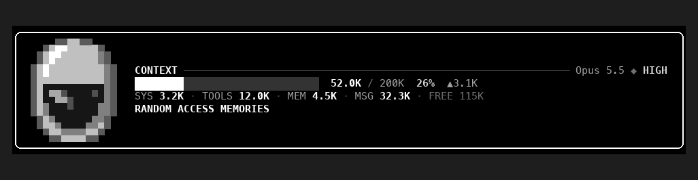

# claude-code-mods

Personal mods for [Claude Code](https://claude.dev/blog/getting-started-with-claude-code-mods/), the terminal AI coding tool. A mod is a small plugin that changes Claude Code's own interface or behaviour. This repo is a plugin **marketplace**, so every mod in it installs with one line.

| Mod | What it does |
| --- | --- |
| [`token-breakdown`](#token-breakdown) | A neon HUD above the prompt that shows your context window's token usage at all times, split into categories, with anime-named colour themes |
| [`daft-tokens`](#daft-tokens) | The same token readout in high-contrast black and white, with a pixel-art silver Daft Punk helmet |

> Both mods draw in the same spot above the prompt, so only one shows at a time. Install the one you like, or install both and switch between them. Hiding is remembered across sessions, so you only switch once:
>
> - **Daft Punk:** `/tokens hide`, then `/daft show`
> - **Neon:** `/daft hide`, then `/tokens show`

## Quick install

Requires **Claude Code 2.1.287 or later** (check with `claude --version`). Inside Claude Code, run:

```
/plugin install token-breakdown --marketplace zh10only1/claude-code-mods
/plugin install daft-tokens --marketplace zh10only1/claude-code-mods
```

Run whichever line you want, or both.

1. Answer **`y`** when it asks to add the `zh10only1/claude-code-mods` marketplace.
2. Choose a scope. **User** loads the mod in every session (recommended), and **Project** loads it in the current repo only.
3. It's active straight away, with no restart needed.

Or add the marketplace once, then pick mods from it:

```
/plugin marketplace add zh10only1/claude-code-mods
/plugin install token-breakdown@zh10only1-mods
/plugin install daft-tokens@zh10only1-mods
```

**Update** to the latest version:

```
/plugin marketplace update zh10only1-mods
/reload-plugins
```

**Remove:** `/plugin uninstall token-breakdown@zh10only1-mods` (or `daft-tokens@zh10only1-mods`)

> Mods run with the same access as Claude Code itself. Read the source before installing any mod, these included. Each one is plain TypeScript under its `hooks/` folder.

---

## token-breakdown

This shows what `/context` shows, without having to run it. A framed HUD sits above the prompt and updates as you work:

```
╭─◢ CONTEXT//TOKENS ◣──────────────────────────────────────────────── Opus 5.5 ◆ HIGH ─╮
│ ████████░░░░░░░░░░░░░░░░░░░░░░  52.0K / 200K  26%  ▲3.1K                             │
│ SYS 3.2K ╱ TOOLS 12.0K ╱ MEM 4.5K ╱ SKILLS 1.1K ╱ MSG 31.2K ╱ FREE 115K              │
╰──────────────────────────────────────────────────────────────────────────────────────╯
```

- **Top edge:** the title, then the model (`Opus 5.5`) and the reasoning effort it runs at (`◆ HIGH`) on the right.
- **Meter:** a fixed 30 cells that fill along the theme's gradient, so a nearly full window reads hot. Beside it are the tokens used out of the window and the percentage, which turns to a warning colour at 60% and a danger colour at 85%. At 85% a `⚠ COMPACT SOON` flag also appears. `▲` shows the tokens added this turn.
- **Readout:** each category's size: system prompt (`SYS`), tools, MCP, memory files (`MEM`), skills, messages (`MSG`) and free space.

### Getting started

After installing, the HUD appears above the prompt **once Claude has answered your first message**, since the first reading comes from that response. From then on it refreshes after every turn, after a compaction, and at most every 3 seconds while tools run.

### Commands

| Command | Effect |
| --- | --- |
| `/tokens` | Opens a detail pane: a bar for each category with its share of the window, plus the largest memory files, MCP servers and skills |
| `/tokens hide` | Hides the HUD above the prompt, in this and later sessions |
| `/tokens show` | Brings it back |
| `/tokens theme` | Lists the themes, marking the one in use |
| `/tokens theme <name>` | Switches theme and remembers it across sessions, e.g. `/tokens theme bebop` |

### Themes

Each theme is named after an anime and recolours the frame, meter, title and readout.

| Theme | Command | Look |
| --- | --- | --- |
| **Ghost in the Shell** (default) | `/tokens theme ghost` | Cyberpunk neon: a cyan → purple → hot-pink glow, magenta accents and a yellow warning |
| **Cowboy Bebop** | `/tokens theme bebop` | The opening's flat colour panels: blue, yellow and red-orange in hard bands, with teal, cream and smoky amber |

Full names work too: `/tokens theme Cowboy Bebop`.

### Good to know

- **No extra cost:** the mod uses Claude Code's own local `summary` estimate, so it makes no extra API calls. Its figures can differ slightly from `/context`, which counts with the token-count API.
- **Best on dark terminals:** the themes are tuned for a dark background.
- **Desktop app:** the HUD also draws in the desktop app's local Code sessions when installed at user scope.

### Troubleshooting

- **No HUD?** Send a message first, since it appears after the first response. Then try `/tokens show`, in case it was hidden.
- **Still nothing?** Run `/reload-plugins`, or restart Claude Code. Check `claude --version` is 2.1.287 or later.
- **Something looks wrong?** Start Claude Code with `claude --debug`. The debug log names any mod that failed to load or draw, and why.

---

## daft-tokens

The same live token readout as token-breakdown, restyled in high contrast: a pure-black panel with a pure-white border, bright white figures, and Thomas Bangalter's silver Daft Punk helmet drawn as pixel art beside it.



<sub>A mock-up rendered from the mod's own pixel and colour data. In the terminal, the helmet is drawn with half-block characters.</sub>

- **The helmet:** chrome dome, shield-shaped glossy black visor with reflections, silver chin. It's 14×16 pixels: each character cell holds two stacked pixels, so it fills 8 rows. It's original pixel art, not a copied image.
- **Top line:** `CONTEXT`, then the model and the reasoning effort it runs at (`Opus 5.5 ◆ HIGH`). The effort shows as soon as the session starts.
- **Meter:** 30 cells of pure white over a dark track, then the tokens used out of the window, the percentage, and `▲` for the tokens added this turn. At 85% the percentage turns inverted (black on white) and `⚠ COMPACT SOON` appears.
- **Readout:** each category's size: `SYS`, `TOOLS`, `MCP`, `MEM`, `SKILLS`, `MSG` and `FREE`.
- **Bottom line:** RANDOM ACCESS MEMORIES.

### Commands

| Command | Effect |
| --- | --- |
| `/daft hide` | Hides the HUD, in this and later sessions |
| `/daft show` | Brings it back |

Like token-breakdown, it appears after Claude's first reply, refreshes after every turn, makes no extra API calls, and is best on a dark terminal.

---

## Developing a mod

```
claude --plugin-dir ./token-breakdown    # run a mod from its folder; saves hot-reload
claude plugin validate ./token-breakdown # check the manifest and hooks module
claude plugin test ./token-breakdown     # run tests/*.test.ts
```

New mods go in their own folder, with an entry added to `.claude-plugin/marketplace.json`.

## License

[MIT](LICENSE): free to use, modify and share.
