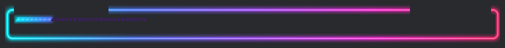
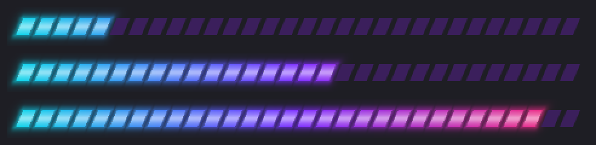

# claude-code-mods

Personal mods for [Claude Code](https://claude.dev/blog/getting-started-with-claude-code-mods/), the terminal AI coding tool. A mod is a small plugin that changes Claude Code's own interface or behaviour. This repo is a plugin **marketplace**, so every mod in it installs with one line.

| Mod | What it does |
| --- | --- |
| [`token-breakdown`](#token-breakdown) | Shows your context window's token usage above the prompt the whole time, split into categories |

## Quick install

Inside Claude Code (2.1.287 or later), run:

```
/plugin install token-breakdown --marketplace zh10only1/claude-code-mods
```

1. Answer **`y`** when it asks to add the `zh10only1/claude-code-mods` marketplace.
2. Choose a scope. **User** loads the mod in every session, and **Project** loads it in the current repo only.
3. It starts working right away, with no restart needed.

Or add the marketplace once, then pick mods from it:

```
/plugin marketplace add zh10only1/claude-code-mods
/plugin install token-breakdown@zh10only1-mods
```

**Update** to the latest version:

```
/plugin marketplace update zh10only1-mods
/reload-plugins
```

**Remove:** `/plugin uninstall token-breakdown@zh10only1-mods`

> Mods run with the same access as Claude Code itself. Read the source before installing any mod, these included. Everything here is in plain TypeScript under each mod's `hooks/` folder.

---

## token-breakdown

This shows what `/context` shows, without having to run it. It's a framed neon HUD that sits above the prompt, in a cyberpunk/synthwave style:

```
╭─◢ CONTEXT//TOKENS ◣──────────────────────────────────────────── Opus 5.5 ◆ HIGH ─╮
│ ████████░░░░░░░░░░░░░░░░░░░░░░  52.0K / 200K  26%  ▲3.1K                              │
│ SYS 3.2K ╱ TOOLS 12.0K ╱ MEM 4.5K ╱ MSG 32.3K ╱ FREE 115K                              │
╰────────────────────────────────────────────────────────────────────────────────────╯
```

- **The frame** glows from neon cyan on the left to hot pink on the right, so the HUD stands apart from the chat. In Ghostty and kitty it's drawn as a real neon tube, with a white-hot line and a soft glow:

  
 It spans the full width, with the model (`Opus 5.5`) and the reasoning effort it runs at (`◆ HIGH`) in the top-right corner.
- **The meter** is 30 cells long. In terminals that can draw real images (**Ghostty**, **kitty**), it's a pixel-drawn neon bar: slanted segments with open gaps, a thin white-hot line through vivid cyan → violet → hot-pink segments, and a neon glow that blooms around the lit stretch. Unlit segments stay dark. Everywhere else, including inside tmux, it falls back to a one-row character bar in the same gradient.

  

- **The figures** sit beside the meter. The percentage turns yellow at 60% and pink at 85%, where a `⚠ COMPACT SOON` flag also appears. `▲` shows the tokens added this turn.
- **The readout** gives each category's size: system prompt, tools, MCP, memory, skills, messages and free space.

Commands:

| Command | Effect |
| --- | --- |
| `/tokens` | Opens a detail pane: per-category bars with share of the window, plus the largest memory files, MCP servers and skills |
| `/tokens hide` | Hides the band above the prompt |
| `/tokens show` | Brings the band back |

It refreshes after every turn, after compaction, and at most every 3 seconds while tools run. It uses Claude Code's local `summary` estimate, so it **makes no extra API calls**. The figures can differ slightly from `/context`, which counts with the token-count API.

---

## Developing a mod

```
claude --plugin-dir ./token-breakdown    # run it; saves hot-reload
claude plugin validate ./token-breakdown # check manifest + hooks module
claude plugin test ./token-breakdown     # run tests/*.test.ts
```

New mods go in their own folder, with an entry added to `.claude-plugin/marketplace.json`.
